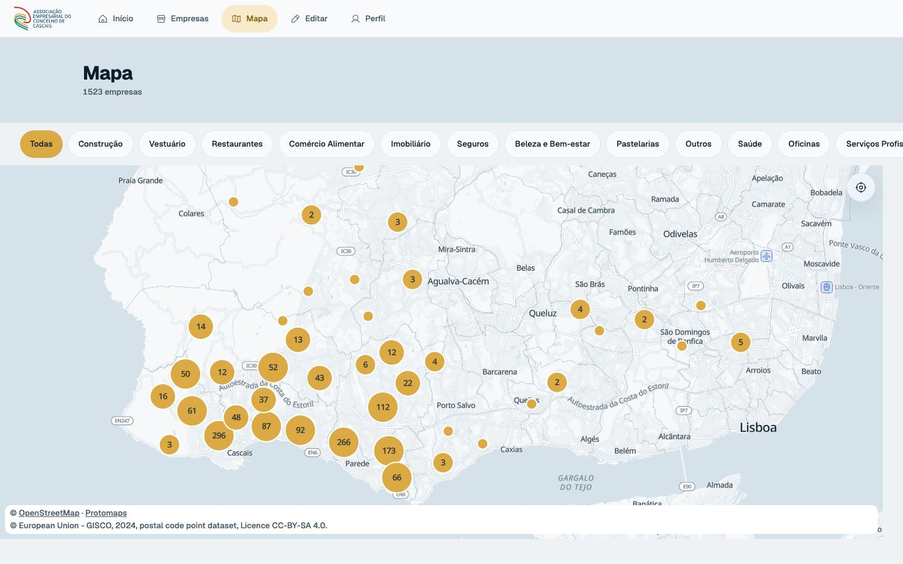
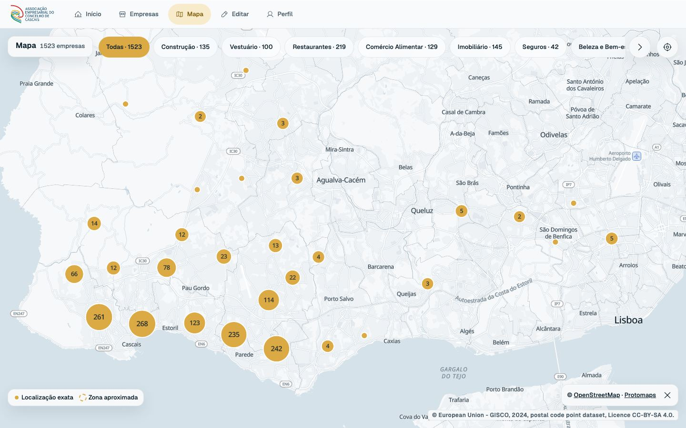
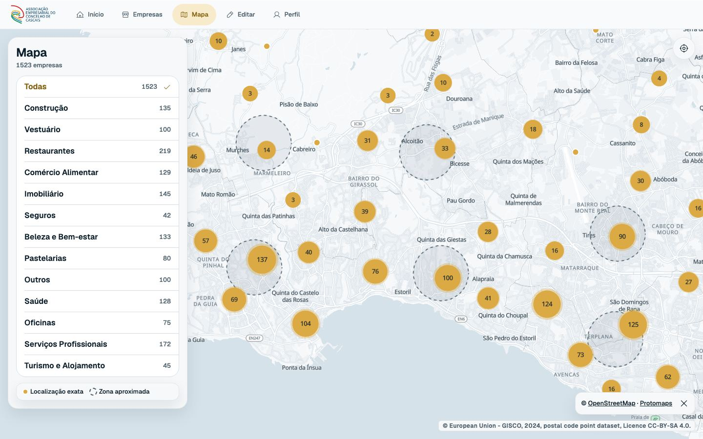
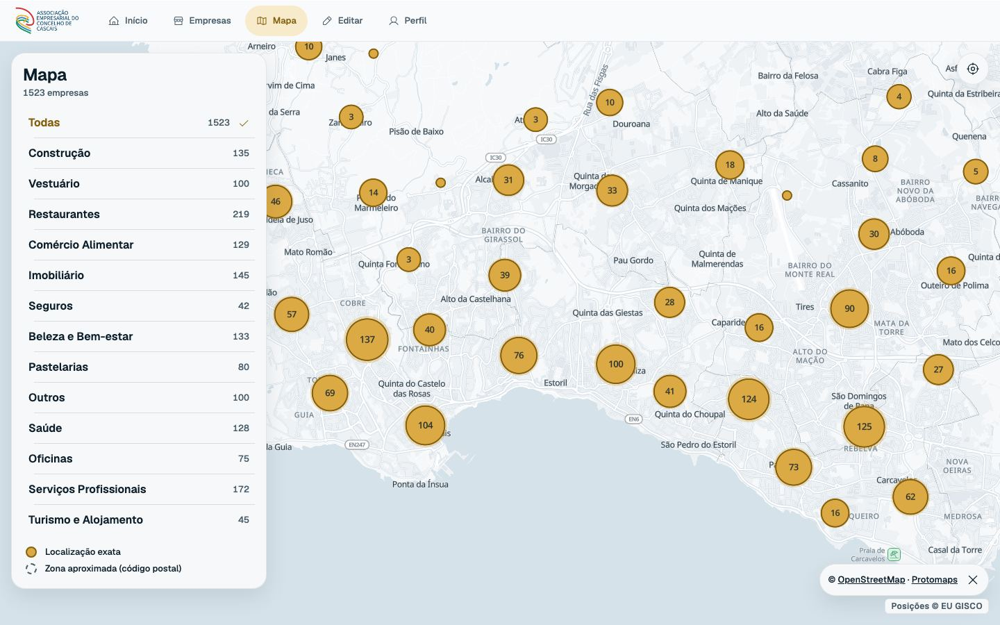
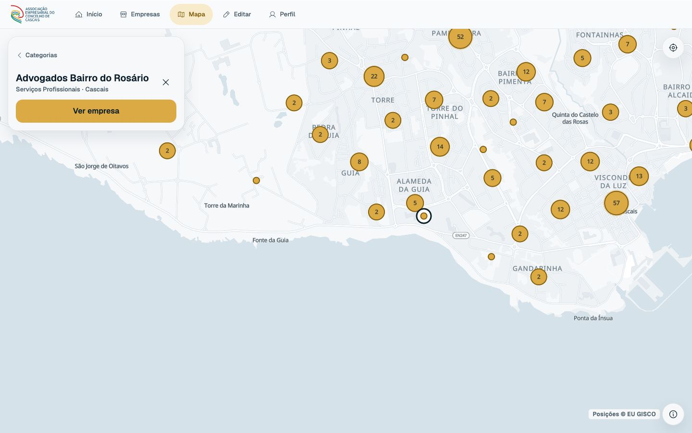

# Refinamento do ecrã do mapa — Fases A e B

**Estado:** Fase B concluída: a direção B "Índice" (com os chips da A no telemóvel e no nativo)
substitui o ecrã do mapa nas 3 plataformas. Resultado no §9. As secções 1–8 são a Fase A, tal como
foi aprovada (o protótipo do §4 saiu do código).
**Branches:** Fase A em `design/mapa-refino`; Fase B em `feat/mapa-refino` (a partir do
`origin/main` b30edde, com as ferramentas de captura e este documento por cherry-pick). Não há
alterações ao `aecc-api`.
**Skill:** design-taste-frontend-v1 (valores por omissão 8/6/4). Em VISUAL_DENSITY 4, a skill pede o
modo "daily app": controlos com espaço, sem caixas a mais e um único acento.

## Resumo

- Hoje o mapa ocupa **≈ 60 %** do ecrã na web e **≈ 45–56 %** no nativo com o card fechado. Com o
  card aberto, desce para **28–42 %**. Os protótipos põem-no em **77–87 %** na web com o card
  fechado e em **62–85 %** com o card aberto (tabela no §5).
- **Recomendação: direção B ("Índice")**, com uma troca: no telemóvel, a fila de chips com contagem
  da A, em vez do botão "Categorias". Razões no §6.
- Decisões que só o Salvador pode tomar: §8.

---

## 1. A0 — Estado atual

### 1.1 Inventário

| Peça         | Ficheiro                                                          | Notas                                                                         |
| ------------ | ----------------------------------------------------------------- | ----------------------------------------------------------------------------- |
| Rota         | `app/(app)/(tabs)/map/index.tsx`                                  | `lazy(MapScreen)`                                                             |
| Stack da tab | `app/(app)/(tabs)/map/_layout.tsx:16`                             | `headerShown: false`, `contentStyle` = `horizon` (faixa da status bar)        |
| Tabs web     | `app/(app)/(tabs)/_layout.web.tsx`                                | headless; `md+` barra de cápsulas no topo; `sm` barra inferior (fora do slot) |
| Tabs nativas | `app/(app)/(tabs)/_layout.tsx`, `src/navigation/tabs.ts`          | NativeTabs; o mapa não tem `managesInsets`                                    |
| Ecrã         | `src/components/map/MapScreen.tsx`                                | `Horizon` + `CategoryChips` + corpo em coluna (`sm`) ou linha (`md+`)         |
| Mapa web     | `src/components/map/CompanyMap.web.tsx`                           | maplibre-gl 5.24.1 + pmtiles, chunk lazy                                      |
| Mapa nativo  | `src/components/map/CompanyMap.tsx`                               | `@maplibre/maplibre-react-native` 11.5.1                                      |
| Camadas      | `src/components/map/companyLayers.ts`                             | `clusters`, `cluster-count`, `point-area`, `point-exact`, `me`                |
| Estilo base  | `src/components/map/styles/mare-{light,dark}.json`, `mapStyle.ts` | Protomaps → Maré (`scripts/map/build-styles.mjs`)                             |
| Atribuição   | `src/components/map/MapAttribution.tsx`                           | sempre aberta, de ponta a ponta                                               |
| Ficha        | `src/components/map/CompanyCard.tsx`                              | `CompanyCard` e `CompanyGroup` (cluster que não se desfaz)                    |

**Clusters:** são da própria `GeoJSONSource` (`cluster: true`, `clusterRadius: 50`,
`clusterMaxZoom: 16`), iguais em web e nativo. Ao tocar num cluster, o mapa faz zoom até à expansão.
Se as folhas estão todas no mesmo ponto (vários ENI no mesmo CP4) ou o zoom já é o máximo, abre a
lista do grupo.

**Card:** tocar num pino muda o `selection` no `MapScreen`, que mostra o `CompanyCard` **no fluxo
do layout**. No `sm` fica por baixo do mapa e encolhe-o; no `md+` fica numa coluna de 400 px à
direita. O `?company=<id>` limpa o filtro, faz `flyTo` a z14 e abre a ficha.

### 1.2 Capturas

Os dados são um **fixture sintético**: nomes inventados e posições dos pontos CP7 do GISCO, com a
distribuição de produção (1523 empresas, 1487 em Cascais, 2 fora da caixa).
Ver `scripts/map/capture/README.md`. Os tiles, glyphs e sprites são uma cópia local do nosso
servidor. Web: Playwright. Nativo: `xcrun simctl io … screenshot` / `adb exec-out screencap`, só
com deep links, **sem Maestro**.

|                          | Claro, card fechado                                          | Claro, card aberto                                          | Escuro, card fechado                                        | Escuro, card aberto                                        |
| ------------------------ | ------------------------------------------------------------ | ----------------------------------------------------------- | ----------------------------------------------------------- | ---------------------------------------------------------- |
| Web 1440×900             | [jpg](mapa-refino/a0/base__desktop__light__card-fechado.jpg) | [jpg](mapa-refino/a0/base__desktop__light__card-aberto.jpg) | [jpg](mapa-refino/a0/base__desktop__dark__card-fechado.jpg) | [jpg](mapa-refino/a0/base__desktop__dark__card-aberto.jpg) |
| Web 390×844              | [jpg](mapa-refino/a0/base__mobile__light__card-fechado.jpg)  | [jpg](mapa-refino/a0/base__mobile__light__card-aberto.jpg)  | [jpg](mapa-refino/a0/base__mobile__dark__card-fechado.jpg)  | [jpg](mapa-refino/a0/base__mobile__dark__card-aberto.jpg)  |
| iOS 26.3 (iPhone 17 Pro) | [jpg](mapa-refino/a0/base__ios__light__card-fechado.jpg)     | [jpg](mapa-refino/a0/base__ios__light__card-aberto.jpg)     | [jpg](mapa-refino/a0/base__ios__dark__card-fechado.jpg)     | [jpg](mapa-refino/a0/base__ios__dark__card-aberto.jpg)     |
| Android 16 (Pixel 8)     | [jpg](mapa-refino/a0/base__android__light__card-fechado.jpg) | [jpg](mapa-refino/a0/base__android__light__card-aberto.jpg) | [jpg](mapa-refino/a0/base__android__dark__card-fechado.jpg) | [jpg](mapa-refino/a0/base__android__dark__card-aberto.jpg) |

### 1.3 Métrica de base: área do ecrã com o mapa visível

- **Web:** fração de uma grelha de 8 px em que o elemento de topo (`elementFromPoint`) é o canvas
  do mapa. Ficam de fora tudo o que tapa o mapa (navegação, título, chips, atribuição, botão,
  card) e as faixas vazias.
- **Nativo:** medição por píxeis nas capturas (altura da faixa do mapa menos a caixa da
  atribuição), com erro de ±1 pp.

| Viewport             | Card fechado | Card aberto |
| -------------------- | -----------: | ----------: |
| Web desktop 1440×900 |       60,2 % |      42,4 % |
| Web mobile 390×844   |       60,7 % |      39,7 % |
| iOS 26.3             |       ≈ 45 % |      ≈ 28 % |
| Android 16           |       ≈ 56 % |      ≈ 39 % |

---

## 2. A1 — Auditoria

As linhas referem-se ao `origin/main` (b30edde).

| #   | Problema                                                                                   | Gravidade              | Causa                                                                                                                                                                                | Proposta                                                                                                                                           |
| --- | ------------------------------------------------------------------------------------------ | ---------------------- | ------------------------------------------------------------------------------------------------------------------------------------------------------------------------------------ | -------------------------------------------------------------------------------------------------------------------------------------------------- |
| 1   | Atribuição com ≈ 70 px no telemóvel e uma barra de ponta a ponta no desktop                | Alta                   | `CompanyMap.web.tsx:44` e `CompanyMap.tsx:50` (`left` + `right`: largura total); `MapAttribution.tsx:37-52` (duas linhas sempre abertas, `meta` 13 px)                               | Canto inferior direito. A OSM recolhe para "(i)" (OSMF §1.5.2). O GISCO numa linha `label` compacta, sem recolher ([A CONFIRMAR], §3.6)            |
| 2   | Título, contagem e filtros ocupam ≈ 25 % da altura no telemóvel                            | Alta                   | `MapScreen.tsx:243` (`Horizon`, `layout.horizonHeight` = 200) e `:244-253` (chips num bloco à parte); `map/_layout.tsx:16`                                                           | Tudo a flutuar por cima do mapa, numa linha: cápsula ou barra de 44                                                                                |
| 3   | Vista inicial mal centrada: metade do desktop mostra Amadora e Lisboa                      | Alta                   | `mapBox.ts:7-12` (centro da caixa, z11 fixo); `CompanyMap.web.tsx:106-107`, `CompanyMap.tsx:126`                                                                                     | Enquadrar pelos dados (`framingBounds`). Os limites simples não chegam (§3.3)                                                                      |
| 4   | Zonas (`area`) como discos grandes e claros, sem legenda: parecem selecionados             | Alta (RGPD de leitura) | `companyLayers.ts:76-79` (`accentSoft` + `circle-radius` 20 px **fixos**: o mesmo disco em z10 e z18); falta a legenda                                                               | Zona geográfica (raio em metros, tracejado) + anel oco no centro + legenda "Localização exata / Zona aproximada"                                   |
| 5   | Clusters escalam pouco (389 ≈ 2) e sobrepõem-se na costa                                   | Média                  | `companyLayers.ts:44-52` (`step` 16/20/24 px); `clusterRadius: 50` (`CompanyMap.web.tsx:68`, `CompanyMap.tsx:133`) menor do que o diâmetro máximo (2 × (24 + 2))                     | Raio ∝ √n (12→32 px na A, 16→40 na B) e `clusterRadius` 60/72                                                                                      |
| 6   | 13 categorias numa fila, cortada no desktop sem aviso; sem contagens                       | Média                  | `CategoryChips.tsx:27` ("sem contagens"), `:39` (sem indicador de scroll); o rato não tem scroll horizontal                                                                          | A: chips com contagem e setas nas pontas; B: lista vertical completa com contagens                                                                 |
| 7   | Desktop: faixa vazia por baixo e margem à direita. No nativo, faixa vazia acima da tab bar | Média (bug)            | `MapScreen.tsx:80` (`paddingBottom` de 40 na web **mesmo no `md+`**, onde não há barra inferior; 96 + inset no nativo); `:37` (`paddingRight` de 32 no `bodyWide`, com ou sem ficha) | Mapa em `absoluteFill`; os controlos usam as insets e a área livre                                                                                 |
| 8   | O pino da ficha aberta não se distingue no mapa                                            | Média                  | Não há camada de seleção                                                                                                                                                             | Anel `text` (camada `point-selected`). Fase B: se a empresa focada ainda estiver num cluster a z14, focar no zoom de expansão (visto no protótipo) |
| 9   | Ao abrir, o card encolhe o mapa (−21 pp no telemóvel): o mapa salta                        | Média                  | `MapScreen.tsx:259-267` (card no fluxo do layout)                                                                                                                                    | O card flutua por cima. O enquadramento e o foco usam `padding` para não ficarem por baixo dele                                                    |
| 10  | O pino dourado sobre o mapa claro tem 2,13:1 (WCAG 1.4.11 pede 3:1 em objetos gráficos)    | Média (a11y)           | `accent` `#DCAA45` sobre `surface`/`bg` claros                                                                                                                                       | Fase B: contorno `text` nos pinos em claro, ou um papel novo `pin` (precisa de aprovação, §8)                                                      |
| 11  | No telemóvel, o pino é difícil de acertar no web (alvo = raio de 8 px)                     | Média (a11y)           | `CompanyMap.web.tsx:141-148` (consulta só no píxel do toque)                                                                                                                         | Consultar uma caixa de 44×44 à volta do toque (protótipo). O nativo já usa 44×44 por omissão (`hitbox`, `PressableSourceProps.d.ts:15-17`)         |
| 12  | Cartão dentro de caixa: no painel do desktop, o `CompanyCard` traz a sua própria `Surface` | Baixa                  | `CompanyCard.tsx:42`                                                                                                                                                                 | Fase B: variante sem superfície, para quando a ficha vive dentro de um painel                                                                      |
| 13  | Botão de posição com vidro translúcido sobre um mapa movimentado                           | Baixa                  | `MapScreen.tsx:198` (`GlassSurface` sem `opaque`)                                                                                                                                    | `opaque` nos controlos sobre o mapa (contraste garantido)                                                                                          |

Todos os pares de texto dos controlos e do card passam AA em claro e escuro. Os valores vêm de
`palette.ts` e `glass.ts`: `text/solid` 15,99 e 12,31; `text2/solid` 6,44 e 6,40; `onAccent/accent`
8,01 e 8,33; `accentText/solid` 5,36 e 6,47. O texto dos chips sobre vidro translúcido depende do
mapa por baixo; na Fase B confirma-se por amostragem nas capturas.

---

## 3. A2 — Duas direções

Comum às duas:

- O mapa ocupa todo o ecrã por baixo da navegação, e no nativo de ponta a ponta.
- Todos os controlos flutuam em `GlassSurface opaque elevated` (sólido fora do iOS 26, por isso o
  contraste AA fica garantido).
- O botão de posição fica em cima à direita. A atribuição fica no canto inferior direito (§3.6).
- Só tokens e primitivas. Sem dependências novas.

### 3.1 Layout por plataforma

|               | **A "Lâmina"**                                                                                                                                                                   | **B "Índice"**                                                                                                                                                                                                                  |
| ------------- | -------------------------------------------------------------------------------------------------------------------------------------------------------------------------------- | ------------------------------------------------------------------------------------------------------------------------------------------------------------------------------------------------------------------------------- |
| Web desktop   | Topo: cápsula "Mapa · 1523 empresas", fila de chips com contagem e setas, botão de posição. Card num painel flutuante à esquerda, por baixo da fila. Legenda em baixo à esquerda | Painel flutuante à esquerda (368 px), com o título e a contagem, as **13 categorias em lista com contagem** e a legenda. Ao tocar num pino, a ficha substitui a lista no mesmo painel ("‹ Categorias"). O mapa fica com o resto |
| Web telemóvel | Linha 1: cápsula título/contagem e botão de posição. Linha 2: chips de ponta a ponta. Card em baixo; a legenda esconde-se enquanto o card está aberto                            | Uma barra: "Todas as categorias · 1523 empresas" + botão "Categorias" (abre uma folha flutuante com a lista), mais o botão de posição. Card em baixo                                                                            |
| iOS 26        | Como no telemóvel web, por baixo da status bar (`insets.top`) e com o card acima da tab bar de vidro                                                                             | Como no telemóvel web                                                                                                                                                                                                           |
| Android       | Como no iOS, edge-to-edge (SDK 55), acima da barra das NativeTabs                                                                                                                | Como no iOS                                                                                                                                                                                                                     |

### 3.2 Pinos e clusters

|               | A                                                                                                                                                                | B                                                                                                                                                                 |
| ------------- | ---------------------------------------------------------------------------------------------------------------------------------------------------------------- | ----------------------------------------------------------------------------------------------------------------------------------------------------------------- |
| Exato         | Ponto `accent` de 6 px, contorno `surface`                                                                                                                       | Igual                                                                                                                                                             |
| Zona (`area`) | Disco **geográfico** de 600 m (polígono, cresce com o zoom; a partir de z12), preenchimento `accent` a 12 %, contorno tracejado `accent`; no centro, um anel oco | Igual, mas **neutro** (`text2`): a zona deixa de usar a cor do pino e não se confunde com uma seleção. Contraste do contorno: 6,86:1 em claro, contra 2,13:1 na A |
| Clusters      | `accent`, raio ∝ √n de 12 a 32 px, contorno `surface`, `clusterRadius` 60                                                                                        | `accent`, raio ∝ √n de 16 a 40 px, com um **halo** do acento a 35 % que cresce com n (dá peso sem tapar o vizinho), `clusterRadius` 72                            |
| Selecionado   | Anel `text` de 3 px                                                                                                                                              | Igual                                                                                                                                                             |
| Legenda       | Cápsula em baixo à esquerda                                                                                                                                      | No painel (desktop) e em cápsula (telemóvel)                                                                                                                      |

RGPD: a zona continua a ser o centróide do CP4 que a API já devolve. O disco só a mostra **maior**
(600 m), nunca mais precisa. Uma empresa `area` nunca é desenhada como ponto cheio. O nome no leitor
de ecrã continua a dizer "zona aproximada".

### 3.3 Enquadramento inicial

`src/components/map/prototype/framing.ts` calcula os limites das empresas **dentro** da caixa
`-9.52,38.62,-9.10,38.86`; as 2 que ficam fora não contam. A seguir, faz `fitBounds` com o
`padding` dos controlos flutuantes.

- **A:** limites simples, como o prompt pede. As 34 empresas de Lisboa, Amadora e Oeiras puxam o
  enquadramento para leste. No desktop vê-se Lisboa inteira. No telemóvel (estreito e alto) o
  `fitBounds` afasta até z≈9,5 e as 1487 de Cascais ficam num só cluster "1.5k"
  ([captura](mapa-refino/a3/a__mobile__light__card-fechado.jpg)).
- **B:** os mesmos limites sem os 3 % mais afastados em cada ponta de cada eixo. Cascais enche o
  ecrã nos dois tamanhos ([desktop](mapa-refino/a3/b__desktop__light__card-fechado.jpg),
  [telemóvel](mapa-refino/a3/b__mobile__light__card-fechado.jpg)). Quem quiser ver Lisboa afasta
  o zoom.

Isto desvia-se do que o prompt pede, por isso é uma decisão do Salvador (§8-3).

### 3.4 Filtros

- **A:** chips com a contagem no rótulo ("Restaurantes · 219"). No desktop, setas "‹ ›" nas pontas
  (`IconButton` de 44) quando há mais chips do que cabem. No telemóvel, o chip cortado na borda já
  mostra que há mais. Um toque muda a categoria.
- **B:** lista vertical com as 13 sempre visíveis e a contagem alinhada à direita (`tabular`). A
  ativa leva `accentText` e um visto. Cada linha tem 44 px; hoje isso é um `style` sobre o
  `ListRow`, porque o `compact` tem 64 (§8-6).
- **Contagens:** vêm do próprio `GET /companies/map` sem filtro: um pedido só, filtrado no cliente.
  Os dados são os mesmos e só o `/map` traz coordenadas (§8-5).

### 3.5 Viabilidade no nativo

A fonte são os tipos instalados (`node_modules`), não a memória.

| Necessidade                                                 | API (versão instalada)                                                                                                                                                                                                                                                            | Viável?                                                                |
| ----------------------------------------------------------- | --------------------------------------------------------------------------------------------------------------------------------------------------------------------------------------------------------------------------------------------------------------------------------- | ---------------------------------------------------------------------- |
| Mapa de ponta a ponta, por baixo da status bar e da tab bar | `NativeTabs` `contentStyle` e `disableAutomaticContentInsets` (expo-router 55.0.18, `build/native-tabs/types.d.ts:48-49`). O Stack já tem `headerShown: false`. O mapa passa a `absoluteFill`                                                                                     | Sim                                                                    |
| Controlos dentro das safe areas                             | `useSafeAreaInsets()` (react-native-safe-area-context 5.6) para o topo e o fundo                                                                                                                                                                                                  | Sim                                                                    |
| Card acima da tab bar                                       | **Não há um hook com a altura da tab bar das NativeTabs**: o `build/native-tabs/hooks.d.ts` só exporta o contexto do `BottomAccessory`. Continua a estimativa de hoje (`insets.bottom` + 96 no nativo)                                                                            | Sim, com uma constante (a confirmar no iOS 26 e no Android na Fase B)  |
| Card como acessório da tab bar (Liquid Glass)               | `NativeTabs.BottomAccessory` (`common/elements.d.ts:201-225`) é **iOS 26+** e fica ao nível do layout (aparece em todas as tabs)                                                                                                                                                  | **Não serve** para a ficha                                             |
| Esconder a tab bar ao mover o mapa                          | `minimizeBehavior` (`types.d.ts:115-140`, iOS 26+) só reage a scroll; o mapa não faz scroll                                                                                                                                                                                       | Não (fica sempre visível)                                              |
| Enquadramento pelos dados com padding                       | `Camera` `initialViewState` com `bounds` e `padding` (`@maplibre/maplibre-react-native` 11.5.1, `components/camera/Camera.d.ts:8-26`, `55-62`, `82-85`) e `fitBounds(bounds, options)` (`:136`)                                                                                   | Sim                                                                    |
| Foco fora da área tapada                                    | `Map` `contentInset` (`components/map/Map.d.ts:245-249`)                                                                                                                                                                                                                          | Sim                                                                    |
| Recolher a atribuição só num gesto                          | `onRegionWillChange` com `userInteraction` (`Map.d.ts:385`, `:42-44`) e `onPress` (`:377`)                                                                                                                                                                                        | Sim                                                                    |
| Atribuição própria                                          | `attribution={false}` e `logo={false}` (`Map.d.ts:306-321`), como hoje                                                                                                                                                                                                            | Sim                                                                    |
| Clusters √n, halo, zonas com tracejado                      | As camadas são especificação de estilo do MapLibre (`prototype/layers.ts`), passadas como `<Layer {...spec} />`. `fill` e `line` com `line-dasharray` e `interpolate` existem no MapLibre Native; `clusterRadius` e `clusterProperties` estão em `GeoJSONSource.d.ts:161`, `:185` | Sim (a validar no dispositivo)                                         |
| Alvo de toque de 44                                         | `hitbox` por omissão de 44×44 (`types/PressableSourceProps.d.ts:15-17`)                                                                                                                                                                                                           | Já existe                                                              |
| Card que se arrasta (folha)                                 | Sem `react-native-gesture-handler` nem `reanimated`                                                                                                                                                                                                                               | **Não, sem aprovação.** A ficha fica estática, com "x" e "Ver empresa" |
| Esc para fechar                                             | Só na web                                                                                                                                                                                                                                                                         | Na web (o "voltar" do Android fecha a ficha; Fase B)                   |

Diferenças entre plataformas que se mantêm:

- No iOS 26, o vidro é `GlassView` (`regular`); no Android, o fallback é sólido.
- No Android a tab bar não é de vidro.
- No nativo não há setas nos chips (a A só as mostra no desktop).

### 3.6 Atribuição

- **OSM e Protomaps:** a OSMF (Attribution Guideline, §1.5.2 "Interactive maps",
  https://osmfoundation.org/wiki/Licence/Attribution_Guidelines#Interactive_maps) diz que "the credit
  should typically appear in a corner of the map". Pode recolher "immediately with a dismiss
  interaction", "automatically on map interaction such as panning, clicking, or zooming" ou
  "automatically after five seconds". Depois, "the user must still be able to find the licence
  information … for example from an '(i)' button in the corner of the map". No protótipo: canto
  inferior direito; recolhe no "x", no primeiro gesto (`dragstart`/`zoomstart` com
  `originalEvent`, ou um clique) e ao fim de 5 s; depois fica o "(i)" de 44, que volta a abrir.
- **GISCO:** a página da Eurostat
  (https://ec.europa.eu/eurostat/web/gisco/geodata/administrative-units/postal-codes) diz: "The
  dataset is released under the CC-BY-SA-4.0 licence and requires the following acknowledgement
  whenever used: © European Union - GISCO, 2024, postal code point dataset, Licence CC-BY-SA 4.0."
  Não diz onde pôr o agradecimento nem se pode recolher. **[A CONFIRMAR]**, por isso **não recolhe**:
  fica sempre visível, com o texto oficial completo, numa linha `label` de 12 px (duas linhas no
  telemóvel). O ano 2024 confere com a página.

Provas no `e2e/web/capture/map-refino.spec.ts`, a passar nas duas direções e nos 4 viewports:

- o "(i)" aparece até aos 5 s + 3 s de tolerância;
- a linha do GISCO continua visível;
- o "(i)" reabre e o "x" recolhe;
- **nenhum pedido sai para fora de `localhost`** (que aqui faz de `aecc.salv4.com`);
- o Esc fecha a ficha.

---

## 4. A3 — Protótipo web

- Código: `src/components/map/prototype/` (`MapPrototype.tsx`, `PrototypeMap.web.tsx`, `layers.ts`,
  `framing.ts`, `PrototypeAttribution.tsx`). O `CompanyMap` de produção não mudou.
- **Interruptor só de desenvolvimento:** `?dir=a|b` só existe com `EXPO_PUBLIC_MAP_PROTOTYPE=1` no
  build (`MapScreen.tsx`). Sem a variável, o Babel do Expo põe `undefined` no lugar dela e o Metro
  corta o ramo e o `import()`. Prova no build de produção: sem chunk `MapPrototype`, e 0 ficheiros
  com `zone-fill` ou "Fontes e licenças". O CI não define a variável. O `CAPTURE=1` do Playwright
  liga-a.
- O nativo (`PrototypeMap.tsx`) é um stub: a Fase A só prototipa na web.

### 4.1 Capturas (8 por direção, mais a atribuição recolhida)

|                         | Desktop claro                                                     | Desktop escuro                                                   | Telemóvel claro                                                  | Telemóvel escuro                                                |
| ----------------------- | ----------------------------------------------------------------- | ---------------------------------------------------------------- | ---------------------------------------------------------------- | --------------------------------------------------------------- |
| A, card fechado         | [jpg](mapa-refino/a3/a__desktop__light__card-fechado.jpg)         | [jpg](mapa-refino/a3/a__desktop__dark__card-fechado.jpg)         | [jpg](mapa-refino/a3/a__mobile__light__card-fechado.jpg)         | [jpg](mapa-refino/a3/a__mobile__dark__card-fechado.jpg)         |
| A, card aberto          | [jpg](mapa-refino/a3/a__desktop__light__card-aberto.jpg)          | [jpg](mapa-refino/a3/a__desktop__dark__card-aberto.jpg)          | [jpg](mapa-refino/a3/a__mobile__light__card-aberto.jpg)          | [jpg](mapa-refino/a3/a__mobile__dark__card-aberto.jpg)          |
| A, atribuição recolhida | [jpg](mapa-refino/a3/a__desktop__light__atribuicao-recolhida.jpg) | [jpg](mapa-refino/a3/a__desktop__dark__atribuicao-recolhida.jpg) | [jpg](mapa-refino/a3/a__mobile__light__atribuicao-recolhida.jpg) | [jpg](mapa-refino/a3/a__mobile__dark__atribuicao-recolhida.jpg) |
| B, card fechado         | [jpg](mapa-refino/a3/b__desktop__light__card-fechado.jpg)         | [jpg](mapa-refino/a3/b__desktop__dark__card-fechado.jpg)         | [jpg](mapa-refino/a3/b__mobile__light__card-fechado.jpg)         | [jpg](mapa-refino/a3/b__mobile__dark__card-fechado.jpg)         |
| B, card aberto          | [jpg](mapa-refino/a3/b__desktop__light__card-aberto.jpg)          | [jpg](mapa-refino/a3/b__desktop__dark__card-aberto.jpg)          | [jpg](mapa-refino/a3/b__mobile__light__card-aberto.jpg)          | [jpg](mapa-refino/a3/b__mobile__dark__card-aberto.jpg)          |
| B, atribuição recolhida | [jpg](mapa-refino/a3/b__desktop__light__atribuicao-recolhida.jpg) | [jpg](mapa-refino/a3/b__desktop__dark__atribuicao-recolhida.jpg) | [jpg](mapa-refino/a3/b__mobile__light__atribuicao-recolhida.jpg) | [jpg](mapa-refino/a3/b__mobile__dark__atribuicao-recolhida.jpg) |

Nas capturas "card aberto", a atribuição ainda está aberta: a captura é tirada aos 4 s, antes da
recolha.

### 4.2 Testes da Fase A

| Camada                                                                                 | Resultado                                           |  Tempo |
| -------------------------------------------------------------------------------------- | --------------------------------------------------- | -----: |
| `npx tsc --noEmit`                                                                     | 0 erros                                             | ≈ 20 s |
| `npx eslint .`                                                                         | 0 erros (1 aviso antigo em `app/auth/callback.tsx`) | ≈ 25 s |
| Auditoria de literais (script da §3.3 do inventário)                                   | **0 / 0 / 2**, igual à base                         |  < 1 s |
| Playwright, só os specs do mapa (`map`, `map-static`, `map-settings`, `map-unlocated`) | **33/33**                                           |   99 s |
| Playwright `--project=capture` (provas das regras + capturas, A e B)                   | 8/8                                                 |  144 s |

Não correu Maestro.

### 4.3 Bundle web (regra 5)

Saída de `scripts/map/capture/bundle-size.sh`, export de produção (`EXPO_PUBLIC_API_URL` de produção):

| Ficheiro                               | Antes (bytes / gzip) |                               Depois, produção | Depois, com o protótipo |
| -------------------------------------- | -------------------: | ---------------------------------------------: | ----------------------: |
| `entry` (inicial)                      |  1 431 374 / 390 797 | 1 431 630 / 390 850 (+256 / +53: ícone `info`) |     1 431 630 / 390 854 |
| `__common` (inicial)                   |            721 / 374 |                                      721 / 374 | **1 242 780 / 302 243** |
| `MapScreen` (lazy)                     |        9 819 / 3 744 |                                  9 883 / 3 765 |           5 925 / 2 552 |
| `CompanyMap` (lazy, maplibre-gl)       |  1 241 663 / 302 153 |                            1 241 663 / 302 153 |           3 860 / 1 790 |
| `MapPrototype` + `PrototypeMap` (lazy) |                    — |                                — (não existem) |      15 253 / 4 866 + … |

O maplibre-gl continua lazy na produção. **Aviso para a Fase B:** no build com o protótipo, dois
módulos importam o maplibre-gl (`CompanyMap.web` e `PrototypeMap.web`). O Metro passa-o para o
`__common`, que o `index.html` carrega logo (+302 KB gzip no arranque). Na Fase B tem de haver um
só componente de mapa, ou o `map.spec` "regra 4" falha.

---

## 5. Área do mapa: antes e por direção (web, card fechado / aberto)

| Viewport                          |          Base |                             A |                   B |
| --------------------------------- | ------------: | ----------------------------: | ------------------: |
| Desktop 1440×900, fechado         |        60,2 % | **86,2 %** (87,0 % recolhida) |     70,2 % (70,9 %) |
| Desktop 1440×900, aberto          |        42,4 % |                        82,3 % |          **85,5 %** |
| Telemóvel 390×844, fechado        |        60,7 % |               76,8 % (77,2 %) | **80,2 %** (80,7 %) |
| Telemóvel 390×844, aberto         |        39,7 % |                        61,7 % |          **65,2 %** |
| Canvas (sem contar sobreposições) | 64,8 / 67,8 % |                 93,3 / 92,9 % |       93,3 / 92,9 % |

O que falta para 100 % no canvas é a navegação web: a barra de cápsulas no desktop e a barra
inferior no telemóvel.

**Nativo (estimativa, a medir na Fase B):** o mapa passa por baixo da status bar e da tab bar
(canvas ≈ 100 %). As sobreposições são as do telemóvel web mais a tab bar flutuante. Espera-se
≈ 75–80 % com o card fechado (A e B) e ≈ 60–65 % com o card aberto, contra os ≈ 45 % / 28 % (iOS) e
≈ 56 % / 39 % (Android) de hoje.

## 6. Comparação e recomendação

| Critério                                   | A "Lâmina"                                               | B "Índice"                                                                  |
| ------------------------------------------ | -------------------------------------------------------- | --------------------------------------------------------------------------- |
| Mapa visível (desktop, fechado / aberto)   | **86 %** / 82 %                                          | 70 % / **86 %**                                                             |
| Mapa visível (telemóvel, fechado / aberto) | 77 % / 62 %                                              | **80 %** / **65 %**                                                         |
| Problema 3 (enquadramento)                 | Não resolve com limites simples (z≈9,5 no telemóvel)     | **Resolve** (corte de 3 %)                                                  |
| Problema 4 (exato vs zona)                 | Melhora (zona geográfica tracejada), mas no mesmo acento | **Resolve melhor:** zona neutra, contraste 6,86:1                           |
| Problema 5 (clusters)                      | √n; ainda se tocam na costa a z11                        | √n + halo + `clusterRadius` 72: separados                                   |
| Problema 6 (categorias)                    | Contagens e setas; continua uma fila                     | **As 13 sempre visíveis no desktop**; no telemóvel exige um toque a mais    |
| Mudar de categoria no telemóvel            | **1 toque**                                              | 2 toques (abrir a folha e escolher)                                         |
| Card                                       | Painel à esquerda (desktop) e em baixo (telemóvel)       | No mesmo painel da lista (desktop): uma só superfície; em baixo (telemóvel) |
| Nativo                                     | Viável                                                   | Viável; a folha de categorias é estática (sem gestos)                       |
| Superfícies flutuantes no desktop          | 4 (título, chips, card, legenda)                         | 2 (painel, atribuição)                                                      |

**Recomendação: B como base, com a fila de chips com contagem da A no telemóvel e no nativo.**

- B resolve os problemas 3, 4 e 5 por inteiro e o 6 no desktop.
- Junta título, categorias, legenda e ficha num só painel: menos caixas a flutuar, como a skill pede
  em densidade 4.
- No telemóvel, os chips da A poupam um toque e um ecrã intermédio. A barra da B fica para o
  telemóvel só se as categorias crescerem para lá das ~15.
- O desktop da B perde mapa com a lista aberta (70 %), mas ganha com a ficha aberta (86 %), que é o
  estado de uso.

## 7. Política de testes proposta para a Fase B (não corrida agora)

- **Em cada alteração:** `tsc`, `eslint`, auditoria de literais e Playwright só do mapa (≈ 2,5 min no
  total, medido acima).
- **No fim de cada bloco de trabalho:** Maestro só dos fluxos do mapa (`mapa`,
  `mapa-posicao-negada`, `push-entre-tabs`), em Android e iOS.
- **Uma vez, antes do PR:**
  - Maestro completo em Android e iOS, com **builds release** (sem LogBox nem Metro);
  - os fluxos que falharem repetem-se **uma vez cada, sozinhos**;
  - Playwright completo.
- Mostrar o tempo de cada camada.
- Acrescento: um spec Playwright para cada regra que o protótipo já prova (atribuição recolhida e
  "(i)", GISCO sempre visível, sem domínios externos, Esc) passa da `capture` para `specs/` quando
  a direção escolhida substituir o ecrã atual.

## 8. Decisões que precisam do Salvador

1. **Direção:** B com os chips no telemóvel (recomendada), B pura ou A.
2. **GISCO [A CONFIRMAR]:** pode a linha oficial recolher para o "(i)", como a OSM, deixando à vista
   a forma curta do NOTICE ("Posições © EU GISCO")? Sem confirmação, fica sempre visível por
   inteiro (duas linhas no telemóvel).
3. **Enquadramento:** aceitar o corte de 3 % (desvio ao "limites das empresas dentro do bbox"),
   porque os limites simples puxam o mapa para Lisboa.
4. **Raio da zona:** 600 m, constante (`ZONE_RADIUS_M`). Um raio maior é mais seguro em termos de
   RGPD; um mais pequeno parece mais preciso do que é. Outra opção: o raio do próprio CP4, mas a API
   teria de o enviar.
5. **Filtro no cliente:** um só `GET /companies/map` dá o mapa e as contagens, em vez de um pedido
   por categoria. Os dados são os mesmos; muda a semântica do filtro (a categoria de topo inclui as
   subcategorias, como no diretório).
6. **Design system:**
   - ícone `info` novo no `Icon` (já incluído, path do Phosphor);
   - densidade de 44 no `ListRow` para a lista de categorias;
   - variante "sem superfície" do `CompanyCard` para o painel;
   - contraste dos pinos em claro: contorno `text`, ou um papel novo (2,13:1 hoje).
7. **Dependências:** sem `gesture-handler`/`reanimated`, a ficha e a folha não se arrastam no
   nativo. Pedir aprovação, ou ficar com o estático (recomendado para a Fase B).
8. **Tab bar no nativo:** continuar com a constante de hoje (`insets.bottom` + 96), porque as
   NativeTabs não expõem a altura da tab bar.
9. **Política de testes da Fase B** (§7).

---

## 9. Fase B — resultado

### 9.1 Decisões do Salvador (19/11/2026) e como ficaram

| #   | Decisão                                                    | No código                                                                                                                                                                                                                                                                                                                                                                                                                                                                               |
| --- | ---------------------------------------------------------- | --------------------------------------------------------------------------------------------------------------------------------------------------------------------------------------------------------------------------------------------------------------------------------------------------------------------------------------------------------------------------------------------------------------------------------------------------------------------------------------- |
| 1   | B "Índice" + chips com contagem no telemóvel e no nativo   | `MapScreen.tsx`: no desktop (web `md+`), painel à esquerda (título, contagem, "Todas" + 13 categorias com contagem, legenda); a ficha substitui a lista no mesmo painel ("‹ Categorias", `map.panel.back`). Telemóvel e nativo: cápsula do título, fila de chips com contagem (`Chip role="radio"`) e botão de posição em cima                                                                                                                                                          |
| 2   | GISCO curto à vista; o oficial e a OSM completa no "(i)"   | `MapAttribution.tsx`: "Posições © EU GISCO" sempre; chip OSM · Protomaps à entrada, que recolhe no "x", no 1.º gesto ou aos 5 s **depois de o mapa carregar**; o "(i)" de 44 abre "Fontes e licenças" (OSM/ODbL, Protomaps, agradecimento oficial do GISCO)                                                                                                                                                                                                                             |
| 3   | Corte de 3 % em cada ponta, dentro do bbox                 | `framing.ts` (`framingBounds`, `FRAMING_TRIM = 0.03`), com o `padding` dos controlos (medido com `onLayout`)                                                                                                                                                                                                                                                                                                                                                                            |
| 4   | Zona = símbolo de tamanho fixo, anel oco tracejado, neutro | `zoneRing.ts`: imagem SDF branca (24 px, anel de 16, traço de 2, 8 traços), pintada com `text2` pela camada `point-area`; não muda com o zoom. Web: `map.addImage` em runtime; nativo: `assets/zone-ring@3x.png`, gerado pela mesma função (`scripts/map/build-zone-ring.mjs`). Legenda "Zona aproximada (código postal)". A `ZONE_RADIUS_M` não existe                                                                                                                                 |
| 5   | Filtro no cliente                                          | `useMapCompanies()` faz um só `GET /companies/map`; `mapFilter.ts` filtra (a categoria de topo inclui as filhas) e conta                                                                                                                                                                                                                                                                                                                                                                |
| 6   | Design system                                              | `info`; `ListRow density="dense"` (44) e `choice` (radio); `Chip role="radio"`; `CompanyCard`/`CompanyGroup` `variant="bare"`; papel `pinEdge` (§9.4)                                                                                                                                                                                                                                                                                                                                   |
| 7   | Sem gesture-handler/reanimated                             | Ficha e painel estáticos, com "x". O Esc (web) e o "voltar" (Android, `BackHandler` só com o ecrã focado) fecham a ficha e o painel das fontes                                                                                                                                                                                                                                                                                                                                          |
| 8   | Tab bar: `insets.bottom` + 96                              | Mantido. iOS 26: a tab bar de vidro começa a 791 pt (de 874) e a ficha acaba a 683 pt. Android: a tab bar começa a 2126 px (de 2400) e a ficha acaba a 2054 px. Nos dois, a ficha fica por cima ([iOS](mapa-refino/b/b__ios__light__card-aberto.jpg), [Android](mapa-refino/b/b__android__light__card-aberto.jpg)). Sobram 108 pt no iOS e 72 px (≈ 27 dp) no Android entre a ficha e a tab bar: a constante chega para a tab bar flutuante do iOS 26 com folga (proposta no relatório) |
| 9   | Política de testes do §7                                   | §9.7                                                                                                                                                                                                                                                                                                                                                                                                                                                                                    |

Correções vistas nas capturas da A3:

- **Chip da OSM cortado a 390 px:** o chip encolhe (`flexShrink`) e a coluna da atribuição tem
  `maxWidth: 100%`. Prova: `map-rules.spec.ts` ("o chip da OSM não sai do ecrã a 390 px") e a
  [captura](mapa-refino/b/b__mobile__light__card-fechado.jpg).
- **4 camadas em baixo com a ficha aberta:** a legenda esconde-se e a OSM recolhe; ficam a ficha, o
  GISCO curto e o "(i)" (`map-rules.spec.ts`; Maestro `mapa.yaml`).
- **Pino selecionado:** fonte própria `selected`, sem clusters, por cima de tudo: o símbolo do pino
  (exato ou zona) dentro de um anel `text` de 3 px sobre `surface`. Vê-se mesmo quando a empresa
  está num cluster que nunca se desfaz (várias empresas no mesmo CP7). Ao focar (`?company=`), o
  mapa aproxima até ao zoom de expansão do cluster que a contém (procura num raio de
  `CLUSTER_RADIUS`, porque o cluster é desenhado no centróide das folhas).
- **Ficha:** nome, categoria e localidade (`GET /companies/{id}` ao abrir; só a `locality` fica em
  estado; sem morada nem coordenadas). O `/map` não mudou.

Encontrado e corrigido na Fase B: as NativeTabs montam o ecrã do mapa antes de a pessoa abrir a tab,
e os 5 s da OSM acabavam sem ela ver o mapa (visto no iOS 26). Agora a OSM volta a aparecer quando o
ecrã fica focado e os 5 s só contam depois de o mapa carregar.

### 9.2 Inventário final

| Peça                  | Ficheiro (`src/components/map/`)                                       |
| --------------------- | ---------------------------------------------------------------------- |
| Ecrã (layout, estado) | `MapScreen.tsx`                                                        |
| Mapa web / nativo     | `CompanyMap.web.tsx` (maplibre-gl, chunk lazy) / `CompanyMap.tsx`      |
| Props partilhadas     | `CompanyMap.types.ts`                                                  |
| Camadas               | `companyLayers.ts` (halo, clusters √n, contagem, zona, exato, seleção) |
| Símbolo da zona       | `zoneRing.ts`, `assets/zone-ring@3x.png`                               |
| Enquadramento         | `framing.ts`                                                           |
| Filtro e contagens    | `mapFilter.ts`                                                         |
| Atribuição / legenda  | `MapAttribution.tsx` / `MapLegend.tsx`                                 |
| Ficha                 | `CompanyCard.tsx` (`variant="bare"`)                                   |

O protótipo saiu: `grep -r "EXPO_PUBLIC_MAP_PROTOTYPE\|prototype/" src app` não devolve nada.

### 9.3 Capturas finais (`mapa-refino/b/`)

Fixture sintético (1523 empresas) e tiles reais numa cópia local. Web: Playwright (`capture`).
iOS 26.3 (iPhone 17 Pro) e Android 16 (Pixel 8): `native-shots.sh` (debug), sem Maestro.

|              | Claro, fechado                                           | Claro, aberto                                           | Escuro, fechado                                         | Escuro, aberto                                         | Atribuição recolhida                                             |
| ------------ | -------------------------------------------------------- | ------------------------------------------------------- | ------------------------------------------------------- | ------------------------------------------------------ | ---------------------------------------------------------------- |
| Web 1440×900 | [jpg](mapa-refino/b/b__desktop__light__card-fechado.jpg) | [jpg](mapa-refino/b/b__desktop__light__card-aberto.jpg) | [jpg](mapa-refino/b/b__desktop__dark__card-fechado.jpg) | [jpg](mapa-refino/b/b__desktop__dark__card-aberto.jpg) | [jpg](mapa-refino/b/b__desktop__light__atribuicao-recolhida.jpg) |
| Web 390×844  | [jpg](mapa-refino/b/b__mobile__light__card-fechado.jpg)  | [jpg](mapa-refino/b/b__mobile__light__card-aberto.jpg)  | [jpg](mapa-refino/b/b__mobile__dark__card-fechado.jpg)  | [jpg](mapa-refino/b/b__mobile__dark__card-aberto.jpg)  | [jpg](mapa-refino/b/b__mobile__light__atribuicao-recolhida.jpg)  |
| iOS 26.3     | [jpg](mapa-refino/b/b__ios__light__card-fechado.jpg)     | [jpg](mapa-refino/b/b__ios__light__card-aberto.jpg)     | [jpg](mapa-refino/b/b__ios__dark__card-fechado.jpg)     | [jpg](mapa-refino/b/b__ios__dark__card-aberto.jpg)     | [jpg](mapa-refino/b/b__ios__light__atribuicao-recolhida.jpg)     |
| Android 16   | [jpg](mapa-refino/b/b__android__light__card-fechado.jpg) | [jpg](mapa-refino/b/b__android__light__card-aberto.jpg) | [jpg](mapa-refino/b/b__android__dark__card-fechado.jpg) | [jpg](mapa-refino/b/b__android__dark__card-aberto.jpg) | [jpg](mapa-refino/b/b__android__light__atribuicao-recolhida.jpg) |

Extra: [zona selecionada no desktop](mapa-refino/b/b__desktop__light__card-aberto-zona.jpg) (o
símbolo fixo da zona dentro do anel da seleção).

### 9.4 Contraste dos pinos e clusters (WCAG 1.4.11, ≥ 3:1)

Medido contra todos os preenchimentos do basemap Maré (`mare-{light,dark}.json`: fundo e terra,
parques, estradas, água e contornos). O valor é o mínimo do conjunto (fórmula WCAG 2.x).

| Elemento                              |                                      Claro |                   Escuro |
| ------------------------------------- | -----------------------------------------: | -----------------------: |
| Antes: acento, contorno `surface`     | **1,56** (água, contornos) a 2,13 (branco) |                     5,15 |
| Contorno `pinEdge` (pinos, clusters)  |                       **4,19** (`#85600F`) | — (`#08161F`, só separa) |
| Preenchimento `accent`                |                                          — |                 **5,15** |
| Zona: anel `text2`                    |                                       5,03 |                     5,10 |
| Seleção: anel `text`                  |                                      12,49 |                     9,80 |
| Número do cluster (`onAccent/accent`) |                                       8,01 |                     8,33 |

O "2,13:1" da Fase A era contra o branco; contra a água e os contornos das estradas, o acento tinha
1,56:1.

**Escolha: papel novo `pinEdge`, não o contorno `text`.** O `text` passaria (12,49:1), mas é a cor
do anel da seleção: com os dois em `text`, o pino selecionado só se distinguiria pelo tamanho. O
`pinEdge` claro é o castanho dourado do `accentText` (o pino continua a ler-se como acento); no
escuro, o acento já passa sozinho e o contorno `bg` só separa pinos vizinhos.

### 9.5 Área do mapa visível

Web: grelha de 8 px com `elementFromPoint` (como na Fase A). Nativo: **medida** na hierarquia de
cada captura, guardada no mesmo instante (`uiautomator dump` / `maestro hierarchy`;
`native-area.mjs`): ecrã menos as superfícies que flutuam por cima e a tab bar
(`b/native-area.json`). Entre parênteses, com a atribuição da OSM já recolhida.

| Viewport             | Ficha   | A0 (antes) |   A3 (protótipo B) |            Final |
| -------------------- | ------- | ---------: | -----------------: | ---------------: |
| Web desktop 1440×900 | fechada |     60,2 % |    70,2 % (70,9 %) |  70,4 % (71,1 %) |
|                      | aberta  |     42,4 % |             85,5 % |       **87,5 %** |
| Web mobile 390×844   | fechada |     60,7 % |    80,2 % (80,7 %) |  74,6 % (76,3 %) |
|                      | aberta  |     39,7 % |             65,2 % |       **68,5 %** |
| iOS 26.3             | fechada |     ≈ 45 % | (estimado 75–80 %) | 73,9 %¹ (76,6 %) |
|                      | aberta  |     ≈ 28 % | (estimado 60–65 %) |       **67,8 %** |
| Android 16           | fechada |     ≈ 56 % | (estimado 75–80 %) |  71,6 % (74,1 %) |
|                      | aberta  |     ≈ 39 % | (estimado 60–65 %) |       **65,6 %** |

¹ No iOS o `maestro hierarchy` leva ≈ 17 s, mais do que os 5 s da OSM, por isso o estado com o chip
da OSM aberto não tem hierarquia própria. 73,9 % = 76,6 % menos a diferença medida no Android entre
os dois estados (2,5 pp de 1080×2400 px = 9 404 dp², que são 2,7 pp dos 402×874 pt do iPhone 17 Pro).

No telemóvel, com a ficha fechada, fica abaixo do protótipo B (74,6 % contra 80,2 %): a decisão 1
trocou a barra de uma linha da B pela fila de chips da A (mais uma linha de 44), e a legenda passou a
estar sempre visível. Com a ficha aberta, que é o estado de uso, fica acima (68,5 % contra 65,2 %).

### 9.6 Bundle web (regra 4)

`scripts/map/capture/bundle-size.sh`, export de produção. O `maplibre-gl` só existe no chunk lazy
`CompanyMap` (o script lista os ficheiros com o marcador `maplibregl-canvas-container`).

| Ficheiro                         | Antes (bytes / gzip) | Depois (bytes / gzip) |        Diferença |
| -------------------------------- | -------------------: | --------------------: | ---------------: |
| `entry` (inicial)                |  1 431 374 / 390 799 |   1 431 852 / 390 953 |      +478 / +154 |
| `__common` (inicial)             |            721 / 374 |             721 / 374 |                0 |
| `MapScreen` (lazy)               |        9 819 / 3 744 |        22 164 / 6 951 | +12 345 / +3 207 |
| `CompanyMap` (lazy, maplibre-gl) |  1 241 663 / 302 153 |   1 244 919 / 303 144 |    +3 256 / +991 |

O `entry` cresce com o ícone `info`, o papel `pinEdge` e as opções novas do `ListRow` e do `Chip`.
Numa primeira versão, o `zoneRing.ts` (importado pela legenda e pelo mapa) e o `framingBounds` (no
`mapBox.ts`, que os ecrãs de definições também usam) foram parar ao `__common`, que o `index.html`
carrega logo (+628 B gzip). A legenda passou a usar os tokens e o enquadramento foi para
`framing.ts`; o `__common` voltou aos 721 B.
